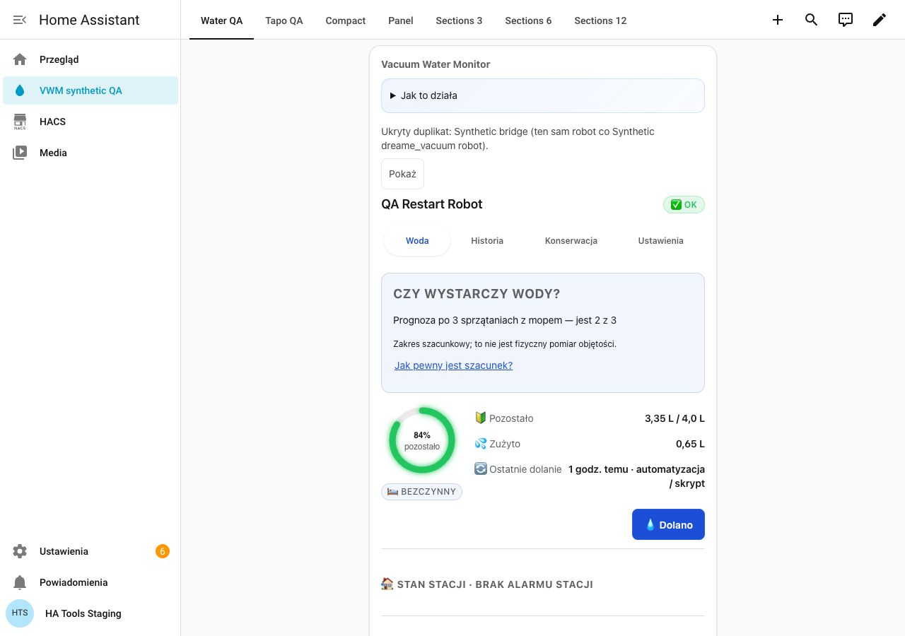
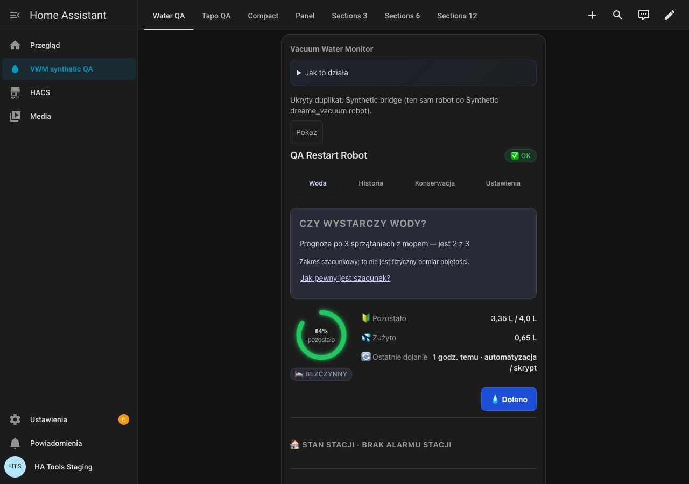
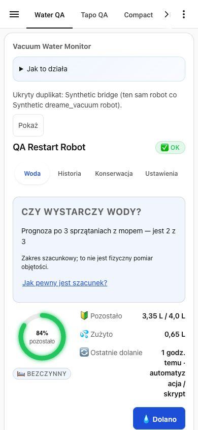
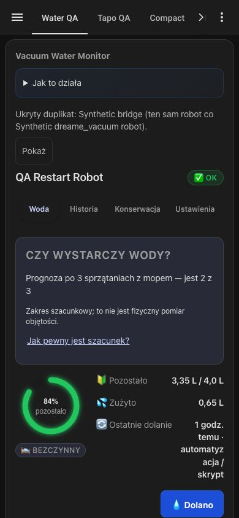
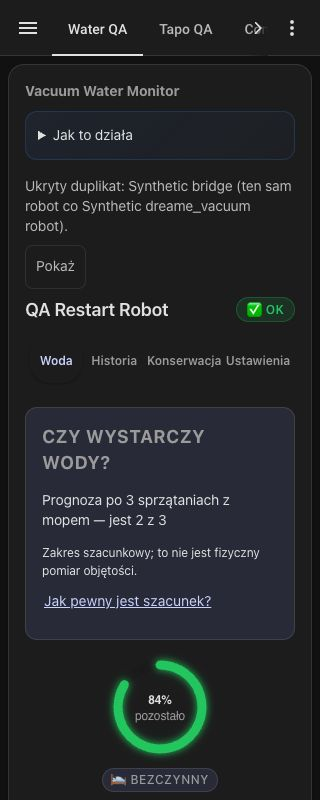
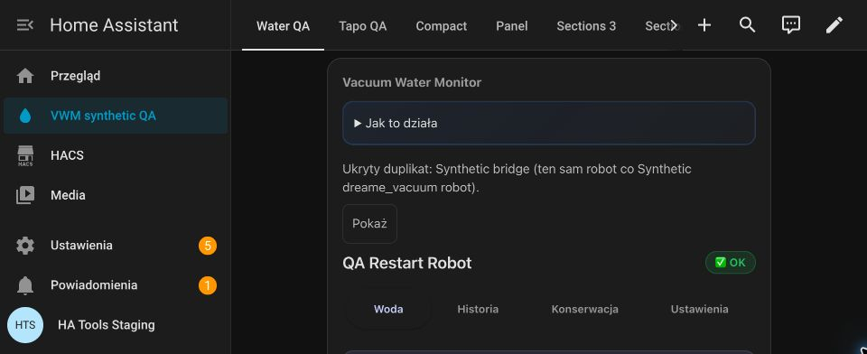
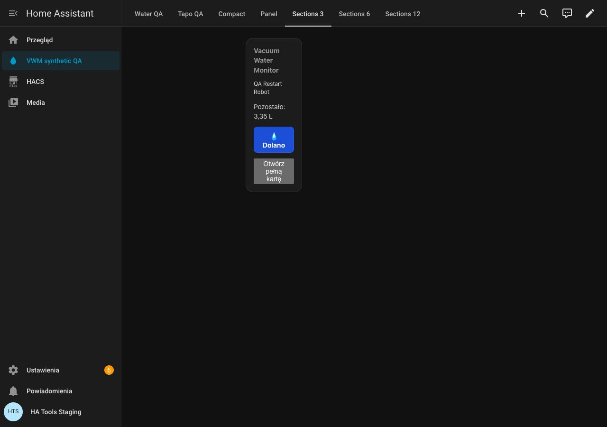
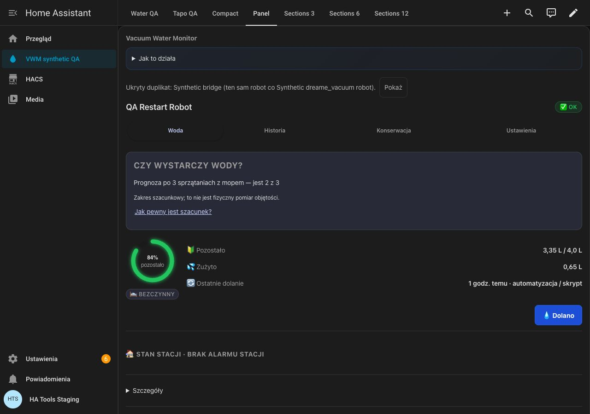

# Version 5.12.0 — UI QA captures

Captured 18 October 2026 in an isolated Home Assistant 2026.10.2 installation. All robots, readings and names are synthetic. These are browser viewport checks; they do not establish physical water accuracy or tests on a particular phone. The native zoom capture uses Chrome’s actual 200% page zoom; vertical scrolling remains available.

## 1280 light

## 1280 dark

## 390 light

## 390 dark

## 320 dark

## Native Chrome 200%

## Sections, 3 columns

## Panel

